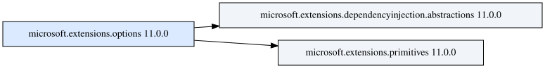
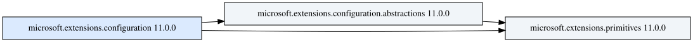
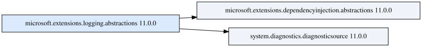

# Практическое занятие №2. Вариант 16

Выполнил Наумов Никита Александрович.

Группа ИКБО-16-25.

**Тема работы**\
Граф зависимостей пакетов NuGet.

Программа читает манифесты `.nuspec` из репозитория NuGet V3, обходит
прямые и транзитивные зависимости и сохраняет граф в DOT и SVG.
Флаг `--ascii` выводит дерево в терминал.

---

<details>
<summary>Перейти к этапу</summary>

1. [Параметры командной строки](#этап-1-параметры-командной-строки)
2. [Сбор данных из NuGet](#этап-2-сбор-данных-из-nuget)
3. [Рекурсивный обход](#этап-3-рекурсивный-обход)
4. [Порядок загрузки](#этап-4-порядок-загрузки)
5. [Визуализация](#этап-5-визуализация)

</details>

## Запуск и проверка

Откройте терминал в каталоге практики. Для запуска нужен Python 3.10
или новее и Graphviz. На Windows программа ищет `dot` в `PATH`.
Если его там нет, пробует запустить `dot` в стандартном дистрибутиве
WSL. На Linux вместо `run.bat` используйте `python3 -B src/main.py`
с теми же опциями. [Командная строка Graphviz][graphviz]

```bat
run.bat --package Microsoft.Extensions.Options --ascii
python -B -m unittest discover -s tests -v
```

Первая команда создаёт `graph.dot` и `graph.svg` в текущем каталоге.
Сборка и сторонние пакеты Python не требуются. На Windows с Python
3.14.7 прошли 19 тестов. SVG проверены через Graphviz 2.43.0 в WSL.

## Этап 1. Параметры командной строки

| Параметр | Значение |
| --- | --- |
| `--package ИМЯ` | Обязательный идентификатор пакета. Для JSON нужна одна буква от A до Z. |
| `--repository АДРЕС` | URL индекса NuGet V3. Стандартный адрес `https://api.nuget.org/v3/index.json`. |
| `--test` | Читает JSON с диска. В этом режиме `--repository` задаёт путь к файлу. |
| `--output ФАЙЛ` | Имя SVG, по умолчанию `graph.svg`. Каталог назначения должен существовать. |
| `--ascii` | Печатает ASCII-дерево. |

[Версия первого этапа][stage1] выводила настройки в формате
`ключ=значение`.

```bat
run.bat --package A --repository examples\diamond.json --test --output graph.svg --ascii
```

```text
package=A
repository=examples\diamond.json
test=True
output=graph.svg
ascii=True
```

Примеры ошибок для пяти параметров.

```bat
run.bat --package /bad
run.bat --package A --repository ftp://example.net/feed
run.bat --package A --test=maybe
run.bat --package A --output graph.png
run.bat --package A --ascii=maybe
```

## Этап 2. Сбор данных из NuGet

Программа находит в индексе ресурс `PackageBaseAddress/3.0.0`.
Оттуда она читает список версий и загружает `.nuspec` выбранной версии.
Для корневого пакета берётся последняя стабильная версия из списка.
HTTP, JSON и XML обрабатывает стандартная библиотека Python.
[Описание NuGet V3][package-content]

Группу зависимостей программа выбирает для проекта `net10.0` без RID.
Она учитывает подходящие группы .NET, .NET Core и .NET Standard.
Пустая подходящая группа означает, что для этой платформы у пакета
нет зависимостей.

[Версия второго этапа][stage2] выводила только прямые зависимости.
Запуск `run.bat --package Microsoft.Extensions.Options` дал такой вывод.

```text
microsoft.extensions.options 11.0.0
- microsoft.extensions.dependencyinjection.abstractions 11.0.0
- microsoft.extensions.primitives 11.0.0
```

## Этап 3. Рекурсивный обход

DFS начинает с корневого пакета. Узел определяется именем и версией.
Если две ветви ведут к одному узлу, программа сохраняет оба ребра
и читает манифест один раз. При возврате к узлу в текущем стеке DFS
программа сохраняет ребро и цепочку цикла, затем обходит другие ветви.
Найденные циклы выводятся в поток ошибок.

Для каждого ребра берётся самая ранняя версия, которая удовлетворяет
ограничению из манифеста. Предварительные версии учитываются, если они
указаны в границе диапазона. При разных требованиях ветвей в графе могут
появиться две версии одного пакета. NuGet для `PackageReference`
подбирает одну версию с учётом графа проекта. [Правила версий NuGet][versions]
и [разрешение зависимостей][resolution].

В тестовом JSON каждому имени пакета соответствует список его прямых
зависимостей. У пакета без зависимостей список пуст. Если ссылка ведёт
к пакету, которого нет в файле, программа выдаёт ошибку.

```bat
run.bat --package A --test --repository examples\diamond.json --ascii
run.bat --package A --test --repository examples\cycle.json --ascii
run.bat --package X --test --repository examples\isolated.json --ascii
```

| Файл | Что проверяется |
| --- | --- |
| [diamond.json](examples/diamond.json) | К пакету D ведут две ветви, через B и через C. |
| [cycle.json](examples/cycle.json) | Программа находит цикл B → C → B и доходит до D. |
| [isolated.json](examples/isolated.json) | В граф попадает один узел X. |

## Этап 4. Порядок загрузки

В [версии четвёртого этапа][stage4] флаг `--order` печатал пакеты
в порядке завершения DFS. В графе без циклов зависимости идут перед
пакетом, которому они нужны. Корневой пакет выводится последним.

```bat
run.bat --package A --test --repository examples\diamond.json --order
run.bat --package X --test --repository examples\isolated.json --order
run.bat --package A --test --repository examples\cycle.json --order
run.bat --package Microsoft.Extensions.Options --order
```

На `diamond.json` программа выводит `D -> B -> C -> A`. На
`isolated.json` выводит только `X`. На `cycle.json` программа
сообщает о цикле `B -> C -> B` и завершает работу с кодом 1.

Для сравнения использован .NET SDK 10.0.400 на Windows. Скрипт
[compare.ps1](examples/compare.ps1) создаёт проекты `net10.0` и закрепляет
версию `11.0.0` каждого корневого пакета. Каждый прогон использует
новую папку пакетов. Строки `Installed` выводятся из журнала
`dotnet restore`.

| Корневой пакет | Порядок DFS | Порядок `Installed` в одном прогоне |
| --- | --- | --- |
| Options | DI → Primitives → Options | DI → Options → Primitives |
| Configuration | Primitives → Configuration.Abstractions → Configuration | Configuration.Abstractions → Configuration → Primitives |
| Logging.Abstractions | DI → DiagnosticSource → Logging.Abstractions | DI → DiagnosticSource → Logging.Abstractions |

DI в таблице обозначает `Microsoft.Extensions.DependencyInjection.Abstractions`.
DiagnosticSource соответствует `System.Diagnostics.DiagnosticSource`.
У остальных имён опущен префикс `Microsoft.Extensions.`. Во всех строках
использована версия пакетов `11.0.0`.

При другом запуске `restore` порядок строк для Options и Configuration
изменился. DFS ставит зависимости перед пакетами, которые на них
ссылаются. Строки `Installed` отмечают запись пакетов в локальный кеш.
В обоих прогонах NuGet восстановил один и тот же набор версий.

## Этап 5. Визуализация

Стрелка в DOT и SVG направлена от пакета к его зависимости. Красный
пунктир отмечает ребро, которое возвращается к узлу в стеке DFS.
В ASCII-дереве помета `[cycle]` обозначает такое ребро. Помета
`[shared]` указывает на пакет, который уже показан в другой ветви.

Если SVG сохранить не удаётся, программа восстанавливает прежний DOT
или убирает новый DOT, если до запуска файла не было.

```bat
mkdir output
run.bat --package Microsoft.Extensions.Options --output output\options.svg --ascii
run.bat --package Microsoft.Extensions.Configuration --output output\configuration.svg --ascii
run.bat --package Microsoft.Extensions.Logging.Abstractions --output output\logging.svg --ascii
```

Ниже показаны графы пакетов версии `11.0.0`, полученные 10 ноября 2026 г.

**Microsoft.Extensions.Options** · [DOT](examples/graphs/options.dot)



**Microsoft.Extensions.Configuration** · [DOT](examples/graphs/configuration.dot)



**Microsoft.Extensions.Logging.Abstractions** · [DOT](examples/graphs/logging.dot)



Для сравнения запустите в PowerShell `pwsh -NoProfile -File .\examples\compare.ps1`.
Скрипт сохраняет журналы восстановления и вызывает `dotnet nuget why`
для двух зависимостей в каждом из трёх примеров. [Описание dotnet nuget why][why]

Для всех трёх примеров имена, версии и рёбра совпали с
`obj/project.assets.json`, который создал `dotnet restore`. Графы
Options и Logging.Abstractions содержат по два ребра. У Configuration
три ребра.
В выводе `dotnet nuget why` для Configuration пакет Primitives виден
в двух ветвях. SVG рисует один узел с двумя входящими стрелками.
В ASCII-дереве повторная ссылка на этот узел помечена `[shared]`.

```text
microsoft.extensions.configuration 11.0.0
|-- microsoft.extensions.configuration.abstractions 11.0.0
|   \-- microsoft.extensions.primitives 11.0.0
\-- microsoft.extensions.primitives 11.0.0 [shared]
```

[stage1]: https://github.com/alarongh/NaumovNA_IKBO_16-25/commit/3a97dadfb81003477d31d72100af71f33a704088
[stage2]: https://github.com/alarongh/NaumovNA_IKBO_16-25/commit/b4e47379410d4a45b984f456bea3d72f077f3d55
[stage4]: https://github.com/alarongh/NaumovNA_IKBO_16-25/commit/04750c92dcf3ca281de3147269840eee752d3cf4
[package-content]: https://learn.microsoft.com/nuget/api/package-base-address-resource
[versions]: https://learn.microsoft.com/nuget/concepts/package-versioning
[resolution]: https://learn.microsoft.com/nuget/concepts/dependency-resolution
[why]: https://learn.microsoft.com/dotnet/core/tools/dotnet-nuget-why
[graphviz]: https://graphviz.org/doc/info/command.html
